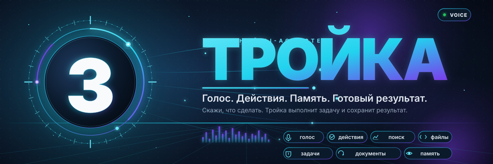

<p align="center">
  
</p>

# Troika 1.0

Troika — voice-first персональный AI-ассистент для Android и Windows. Голос —
главный интерфейс. Чат остаётся дополнительным способом ввода и просмотра
деталей.

> Скажи Тройке, что нужно сделать. Она поймёт задачу, сама выберет нужные
> инструменты, выполнит работу, сохранит результат и будет помнить контекст в
> следующий раз.

Troika продаётся как личный AI, который экономит время в повседневных,
учебных и рабочих задачах. Пользователю не нужно выбирать модель, режим агента
или внутренний инструмент.

## Для кого

| Пользователь | Главная задача | Сценарий Troika 1.0 |
|---|---|---|
| Студент | Разобраться с заданиями и файлами | Голосом попросить объяснить задание, найти информацию, подготовить DOCX/PPTX и напомнить отправить. |
| Начинающий специалист | Быстрее справляться с письмами, исследованиями, документами и рутиной | Попросить подготовить отчёт, сравнение, файл, поиск и список следующих действий. |
| Разработчик или power user | Делегировать сложную работу без ручного выбора внутренней архитектуры | Поручить research, работу с файлами или coding-задачу; BYOK и дополнительные возможности остаются в Advanced. |
| Обычный пользователь | Получить результат без изучения сложного AI-интерфейса | Сказать естественной фразой: «напомни», «найди», «открой» или «сделай документ». |

## Что получает пользователь

- голосовой запуск задачи с главного экрана;
- выполненное действие, файл, найденную информацию, задачу или короткий ответ;
- сохранённые результаты и owner-scoped память, которую можно посмотреть,
  изменить или удалить;
- понятное одноразовое подтверждение перед чувствительным действием;
- один интерфейс Тройки без выбора моделей, tools, workers и agent framework.

Troika 1.0 находится в разработке. Публично обещаются только возможности,
которые прошли проверки из канонического плана. Экспериментальные функции
сохраняются в коде, но не входят в обычный UI и маркетинг до отдельных gates.

## Документы продукта

- [Главный план Troika 1.0](docs/Troika_1.0_Launch_Plan_Final_Updated.docx)
- [Трекер реализации](docs/TROIKA_1_0_EXECUTION_TRACKER.md)
- [Текущий проверенный статус](PROJECT_MEMORY.md)
- [Вспомогательный план реализации](PRODUCTIZATION_PLAN.md)
- [План безопасного восстановления возможностей](docs/TROIKA_CAPABILITY_RESTORATION_PLAN.md)

DOCX — основной план продукта. Он определяет scope, UX, тарифы, порядок релиза
и Definition of Done. Остальные документы фиксируют исполнение и не
переопределяют Word-план.

## Принципы интерфейса

- Voice-first: говорить можно сразу, без перехода в чат.
- Action-first: приоритет у результата, а не у длинного ответа.
- One assistant: внутреннюю маршрутизацию выбирает Troika.
- Minimal settings: редкие технические параметры находятся в Advanced.
- Safe actions: внешние эффекты требуют ясного approval.
- User-controlled memory: пользователь управляет сохранёнными фактами.

## Архитектура продукта

```text
Android / Windows
       |
     HTTPS
       |
Troika API Gateway
       |
Auth + Device + Entitlement
       |
Owner-scoped Run
       |
Router + Tools + Approval
       |
Result + Artifact + Task + Memory
```

Обычный клиент получает короткие статусы и готовый результат. Названия моделей,
провайдеров, внутренних tools и скрытые рассуждения остаются внутри runtime.

## Разработка

Основная рабочая копия продукта — этот репозиторий. Исторические имена Hermes в
некоторых путях и compatibility identifiers пока сохраняются только для
безопасной миграции данных и сборки.

### Локальный запуск gateway

```bash
python cli.py --gateway
python stt_proxy_server.py
```

Проверка:

```bash
curl http://localhost:8642/health
```

### Android

```bash
cd hermes-android
flutter test
flutter analyze --no-fatal-infos
flutter build apk --debug
```

### Основные каталоги

| Каталог | Назначение |
|---|---|
| [`troika_product/`](troika_product/) | Product auth, ownership, usage и данные подписочного продукта. |
| [`gateway/`](gateway/) | API, runs, events, approvals и интеграции клиентов. |
| [`tools/`](tools/) | Внутренние возможности runtime; product toolset содержит только проверенный allowlist. |
| [`hermes-android/`](hermes-android/) | Общий Flutter-клиент Android/Windows; исторический путь временно сохранён. |
| [`docs/`](docs/) | Канонический план, security reviews, runbooks и execution tracker. |

## Лицензия и происхождение

MIT — см. [LICENSE](LICENSE). Обязательные notices исходных компонентов
сохраняются.

Troika основана на open-source проекте
[Nous Research Hermes-Agent](https://github.com/NousResearch/Hermes-Agent), но
пользовательский продукт, его UX, безопасность и release scope определяются
планом Troika 1.0.
