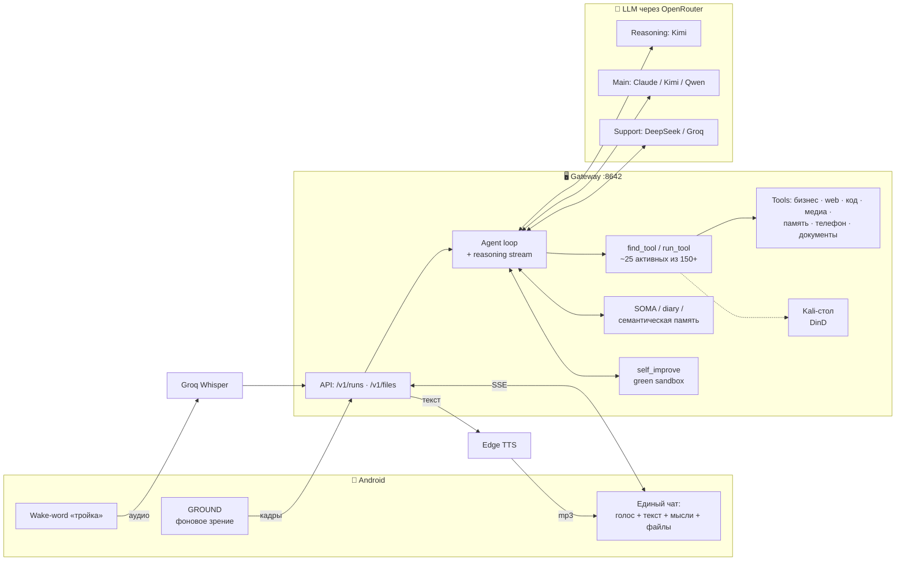

<p align="center">
  
</p>

<p align="center">
  
  
  
  
  
  
</p>

<h3 align="center">Скажи «тройка» — и она слушает.</h3>
<p align="center">
Личный AI-агент и бизнес-партнёр, который работает 24/7.<br/>
Распознаёт речь, отвечает живым голосом, помнит контекст, думает как человек — и <b>сама пишет себе инструменты, если чего-то не хватает</b>.
</p>

---

## Почему это не «ещё один голосовой ассистент»

|  | Обычный ассистент | Тройка |
|---|---|---|
| Wake-word | по кнопке | **«тройка»** — слушает в фоне |
| Реакция | шаблонные ответы | **живой голос + характер**, лёгкая ирония, своё мнение |
| Мышление | скрыто | **виден поток мыслей** прямо в приложении |
| Инструменты | фиксированный список | **150+ + сама допишет новый**, если нет нужного |
| Инициатива | ждёт команду | **пишет сама**, когда есть что сказать (DAEMON) |
| Зрение | нет | **видит экран телефона** в фоне (GROUND) |
| Память | нет / чат | **постоянная память + дневник + семантический поиск** |
| Пентест | — | **отдельный Kali-стол** для аудита своих систем |
| Себя чинит | нет | **правит собственный код** через git-ветки |

---

## Что умеет

### 🗣️ Голос
- Wake-word **«тройка»**, распознавание речи ~1 с (Groq Whisper), живой TTS с интонацией (Edge TTS).
- **Единый чат**: голос и текст в одной ленте, можно начать голосом — продолжить текстом.
- **Адаптивный barge-in**: перебиваешь голосом в любой момент, эхо-фон калибруется.
- Характер: не подлизывает, говорит правду, имеет своё мнение.

### 🧠 Видно, как она думает
- **Поток мыслей** в приложении — реальные рассуждения и вызовы инструментов в реальном времени.
- **Офлайн-перевод мыслей** EN→RU прямо на телефоне (Google ML Kit), бесплатно.

### 📊 Бизнес-аналитик
Работает на **реальных данных** (веб-поиск) через проверенные фреймворки, а не общими словами. Честно скажет, если идея слабая.
- **Анализ конкурентов** — карта игроков, УТП, цены, где обойти.
- **Анализ рынка** — объём, динамика, тренды, барьеры входа.
- **Стратегия** — SWOT, unit-экономика (CAC/LTV/маржа/churn), риски.
- **Маркетинг** — ЦА через JTBD, позиционирование, воронка AARRR.

### 📄 Документы и презентации
- Все длинные отчёты — сразу в **Word (.docx)**: открываешь, пересылаешь, печатаешь.
- **Презентации в .pptx** — с фото и самонарисованной графикой, не «AI-slop».
- Пишет **как живой эксперт, без признаков ИИ** — без канцелярита и дежурных штампов.

### 🔎 Поиск и исследования
- **Веб-поиск** по всему интернету (Tavily) — ищет сама, не открывает браузер.
- **Глубокое исследование** темы под разными углами с перепроверкой и структурным отчётом.
- **web_research** — голосом «разберись и ответь коротко» одним запросом.

### 💻 Создаёт и делегирует
- **Пишет код** через под-агента-кодера (Claude/Gemini/Qwen CLI). Проект в фоне — результат присылает.
- **Проекты по фазам**: vision → требования → архитектура → задачи → код.
- **Дизайн** — production-grade UI-макеты, потом по ним кодит.
- **Медиа** — генерация изображений (FLUX/SDXL) и видео (LTX) без API-ключей.
- **Фоновые задачи** — до 3 параллельно, с heartbeat-уведомлениями по готовности.

### 🧪 Kali-стол
Второй рабочий стол в отдельном контейнере — для аудита **своих** систем (пентест по одноразовому подтверждению).
- Полный тулинг Kali в DinD.
- Переключаемый «мозг под задачу»: атака / защита / OSINT.
- Обучена методологии (OWASP, ATT&CK, HackTricks) и фазам.

### 🛠️ Мета-инструменты (у Тройки 150+ tools)
- **find_tool** — поисковый роутер по 150+ инструментам, в активном наборе держится ~25 ходовых ради скорости.
- **run_tool** — запуск найденного.
- **what_can_i_do** — сама рассказывает свои возможности голосом.
- **ensure_capability** — *«нет тула для задачи → сама пишу и продолжаю»*. Async-фасад над self_improve+job_runner.

### 🧬 Самоулучшение
- Правит собственный код через git-ветки в **зелёной песочнице** (LLM-ключи пробрасываются, проверяется сборка).
- Применяет изменения **только владелец** — Тройка предлагает, ты нажимаешь.
- Создаёт новые навыки (skills) из опыта.

### 🧠 Память и рост
- **Постоянная память** о тебе (привычки, предпочтения, планы) + дневник по дням.
- **SOMA по релевантности** — память подмешивается в контекст по теме реплики, а не «всё разом».
- **Семантический поиск** по фактам и прошлым диалогам.
- **Самоанализ** — отмечает удачи и ошибки.

### 🎯 Проактивная инициатива
- **DAEMON** — Тройка сама решает, писать тебе или нет: не дёргает по таймеру, а думает «есть ли что сказать».
- **GROUND** — фоновое зрение экрана телефона (Qwen2.5-VL): реагирует на то, что видит, а не «вслепую».

### 📱 Управляет телефоном
- Будильники, таймеры, напоминания, звонки, SMS, открытие приложений.
- **GPS** (включая фоновую) с обратным геокодированием.
- **Telegram** — шлёт тебе текст и файлы в избранное.

### ⏰ Работает 24/7
- Автозапуск на машине, keep-alive, восстановление после сбоев.
- **Watchdog**: Kotlin-нить + серверный cron — рестарт при провале `/health`, мозга или STT.
- Чинит сама себя: диагностирует и устраняет сбои, продолжая работу.

---

## Как это устроено



- **Gateway** (порт 8642) — мозг: LLM, инструменты, TTS, документы, API файлов.
- **STT-прокси** — распознавание речи (Groq Whisper).
- **Телефон** ловит «тройка», шлёт аудио → текст → gateway → голосовой ответ + поток мыслей + документы.

Сервер работает локально (ноутбук/мини-ПК) или как Docker-сервис на VPS — приложение подключается по сети.

---

## Запуск

**Локально:**
```bash
python cli.py --gateway          # gateway (порт 8642)
python stt_proxy_server.py       # STT-прокси
```

**Сервер (VPS):**
Docker-образ `troika03/troika:latest`, автопубликуется CI на пуш в `main`. APK клиента собирается из [`hermes-android/`](hermes-android/).

**Проверка живости:**
```bash
curl http://localhost:8642/health
```

---

## Структура проекта

| Каталог | Что внутри |
|---|---|
| [`tools/`](tools/) | 150+ инструментов: бизнес, исследования, документы, поиск, код, медиа, память, Kali |
| [`skills/`](skills/) | Навыки-знания (бизнес/стартап-мышление, голосовой роутинг, методология пентеста) |
| [`agent/`](agent/) | Ядро агента: цикл рассуждений, работа с моделями, reasoning stream |
| [`gateway/`](gateway/) | HTTP-сервер: API чата, `/v1/runs` (SSE мыслей), файлы, сессии |
| [`hermes-android/`](hermes-android/) | Android-приложение (Flutter): чат, голос, мысли, файлы, GROUND |
| [`docker/`](docker/) | Личность (SOUL), серверная конфигурация, деплой |
| [`docs/`](docs/) | Планы: [Kali-стол](docs/TROIKA_KALI_WORKSPACE_PLAN.md) · [ПК-агент](docs/TROIKA_PC_AGENT_PLAN.md) · [Монетизация](docs/TROIKA_MONETIZATION_PLAN.md) |

> Каталог `hermes-android/` — исторический путь, оставлен ради стабильности сборки APK. Приложение — Тройка.

---

## Стоимость

Тройка работает на платных LLM (через OpenRouter). Ориентир на одного активного пользователя:

| Нагрузка | Стоимость мозга | Инфраструктура |
|---|---|---|
| Умеренная | **$20–30/мес** | VPS от $5/мес |
| Плотная (десятки запросов/день, бизнес-разборы) | **$80–90/мес** | тот же VPS |

STT (Groq), веб-поиск (Tavily) и перевод мыслей — на бесплатных тарифах.

---

## Лицензия

MIT — см. [LICENSE](LICENSE).

Форк [Nous Research Hermes-Agent](https://github.com/NousResearch/Hermes-Agent), сильно перестроенный под голос, память, бизнес-задачи, самоулучшение и Kali-стол.
